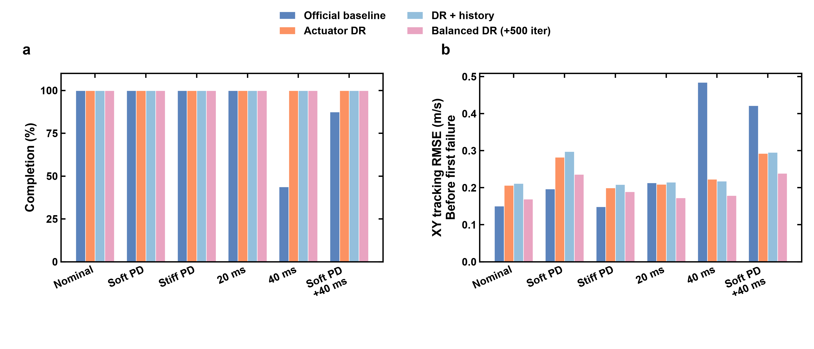
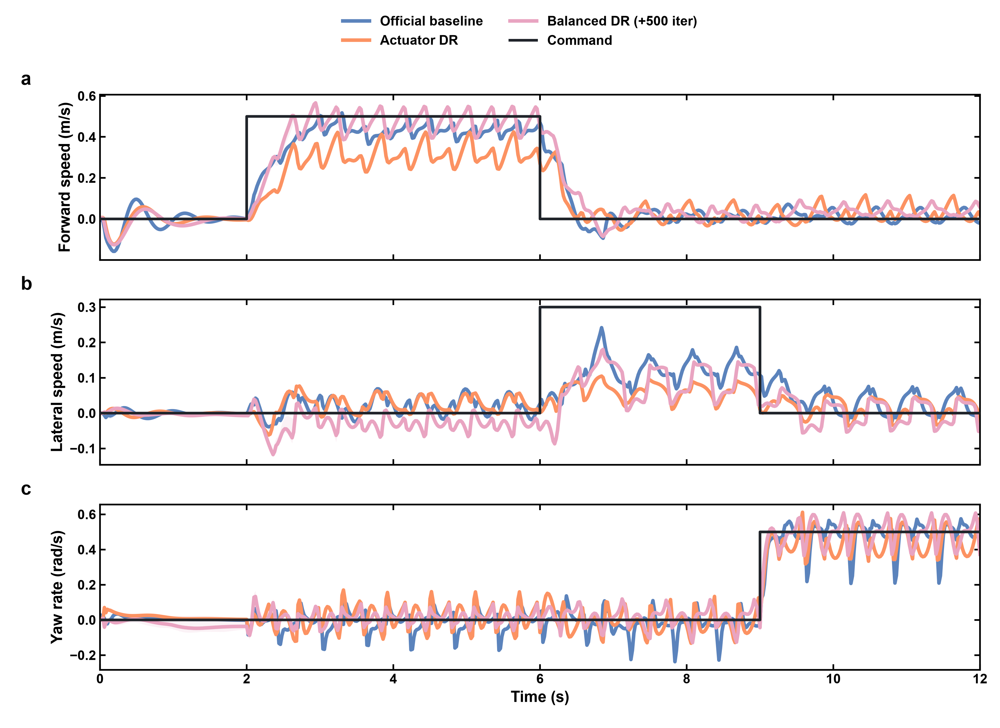
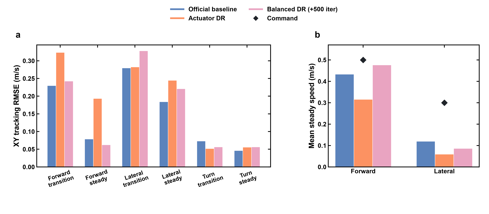
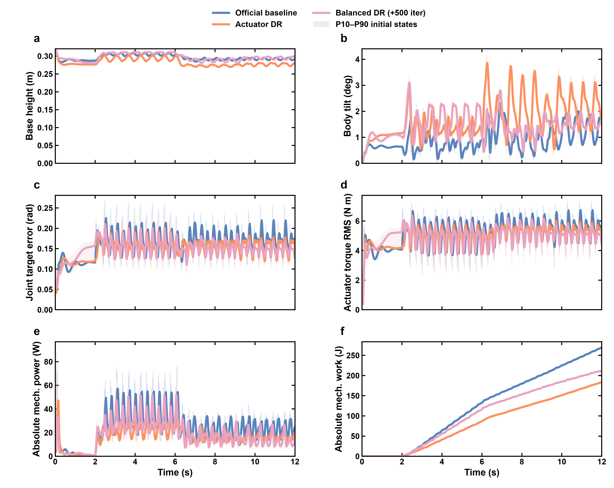
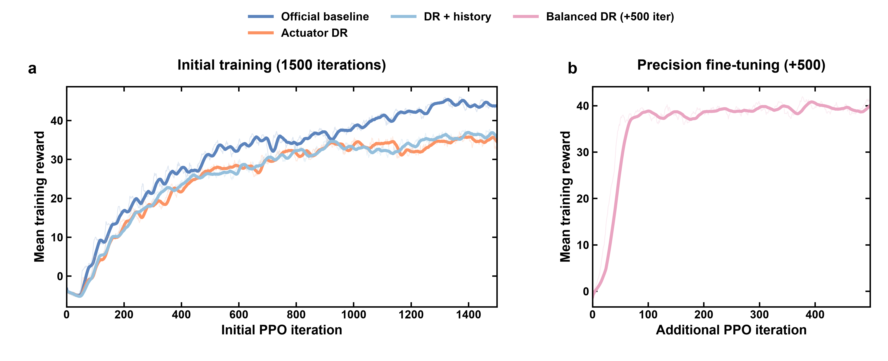

<div align="center">

# Go2 Actuator Robustness

**Unitree Go2 四足机器人速度跟踪与执行器鲁棒性工程**

MuJoCo · PPO · Unitree RL Mjlab · Python · RTX 4060 Laptop

[工程设计](docs/ENGINEERING.md) · [指标与源数据](reports/precision_evaluation.csv) · [五图索引](reports/visualization/README.md) · [运行说明](docs/REPRODUCTION.md)

</div>

## 项目概览

在宇树官方 Go2 强化学习环境上，构建动作延迟、关节 PD 参数变化下的训练与评估流程。
工程重点是把“机器人能走”推进为“在明确工况下，能量化说明它走得是否稳定、跟踪是否准确”。

项目完成了环境部署、PPO 训练、执行器随机化、固定工况评估、误差定位与精度微调，
并保留配置、训练记录、逐回合指标和绘图源数据。当前结果来自 MuJoCo 仿真。



## 关键结果

| 策略 | 累计训练迭代 | 标称 XY RMSE ↓ | 40 ms 延迟完成数 ↑ | 40 ms 延迟 XY RMSE ↓ |
| :--- | ---: | ---: | ---: | ---: |
| 官方基线 | 1500 | **0.151 m/s** | 7 / 16 | 0.485 m/s |
| 执行器随机化（DR） | 1500 | 0.206 m/s | **16 / 16** | 0.223 m/s |
| DR + 四帧观测历史 | 1500 | 0.211 m/s | **16 / 16** | 0.218 m/s |
| 平衡混合微调（Balanced DR） | **2000** | 0.169 m/s | **16 / 16** | **0.179 m/s** |

- **延迟适应：**同等 1500 轮预算下，DR 将该 40 ms 工况完成数从 7/16 提升到 16/16。
- **精度修正：**DR 基础上追加 500 轮平衡混合微调，标称误差从 0.206 降到 0.169 m/s，同时保留延迟工况的完成表现。
- **工程验收：**微调策略在预定义六种工况中均完成 16/16 回合，通过原先设定的标称误差与延迟完成率门槛。

这里的 16 个初始状态按策略配对；每种策略仅有一个训练种子。
Balanced DR 使用了额外训练预算，表中明确单列，不能据此宣称等预算算法优势。
横移稳态仍存在欠速，见下方误差分解。[完整指标](reports/precision_evaluation.csv) · [预定义验收条件](configs/acceptance.json)

## 工程改动

| 模块 | 实现内容 | 对应代码 |
| :--- | :--- | :--- |
| 动作执行延迟 | 每回合固定 0/20/40 ms；FIFO 在策略控制周期内推进；按环境独立清空 | [actions.py](go2_robust/actions.py) |
| PD 参数随机化 | 每次重置对各关节增益独立缩放，范围为标称值的 0.75–1.25 | [tasks.py](go2_robust/tasks.py) |
| 精度微调 | 50% 标称控制回合与 50% 执行器随机化回合混合，重置掩码保持一致 | [events.py](go2_robust/events.py) |
| 观测历史 | 复用上游历史缓冲；四帧 actor 输入从 47 维扩展到 188 维 | [tasks.py](go2_robust/tasks.py) |
| 固定工况评估 | 统一指令、初始状态和首个失败判据，记录误差、完成率及控制代价 | [evaluate.py](go2_robust/evaluate.py) |
| 误差诊断与出图 | 分运动阶段定位误差；从已保存数据生成五组工程图 | [diagnose.py](go2_robust/diagnose.py) · [visualize.py](go2_robust/visualize.py) |

控制链路：目标速度与机器人状态 → PPO 策略 → 动作 FIFO → 关节 PD → MuJoCo → 状态反馈。

复用官方 PPO、网络隐藏层、奖励函数和 Go2 模型。上游本身已有摩擦/质心随机化、
PD 随机化原语和观测历史功能；本仓库增加延迟语义、任务集成、配对评估与工程诊断。
[设计细节](docs/ENGINEERING.md)

## 速度跟踪与误差定位



黑实线表示目标指令，彩色实线表示策略响应。图覆盖前进、横移、转向三个阶段。
曲线汇总 16 个初始状态；半透明带为初始状态间的 P10–P90 范围。
前进稳态速度在微调后更接近目标，横移欠速仍清晰可见。



逐时刻诊断发现，DR 相对基线增加的跟踪平方误差约 73% 集中在前进和横移稳态窗口。
据此采用平衡混合微调，保留原 PPO 与奖励配置。
[精度阶段记录](reports/PRECISION_STAGE.md) · [分阶段数据](reports/precision_segments.csv)

<details>
<summary><strong>展开：机器人状态与控制代价</strong></summary>



记录机身高度、倾角、关节目标误差、力矩 RMS、机械功率与机械功。
机械功指标是仿真控制代价代理量，不等同于电池耗电。

</details>

<details>
<summary><strong>展开：训练过程与追加预算</strong></summary>



初始训练为每种策略 1500 轮；平衡混合微调追加 500 轮，使用独立横轴。
粗线为 25 轮尾随平均，浅色曲线保留原始值。训练条件不同，奖励排名不能替代固定工况评估。

</details>

## 评估协议

- **六种工况：**标称 PD、0.75 倍 PD、1.25 倍 PD、20 ms 延迟、40 ms 延迟、0.75 倍 PD + 40 ms 延迟。
- **回合：**每工况 16 个配对初始状态，评估种子 2026，总时长 12 秒；评分跳过最初 2 秒。
- **指令：**0–2 秒站立；2–6 秒前进 0.5 m/s；6–9 秒横移 0.3 m/s；9–12 秒转向 0.5 rad/s。
- **失败：**机身高度低于 0.14 m，或倾角超过 70°。首次失败后不通过自动重置重新进入评分。
- **误差：**XY RMSE 表示平面速度误差的均方根；使用首个失败前的有效样本，并同时报告完成率和覆盖率。

[评估配置](configs/evaluation.json) · [评估记录](reports/receipts.json) · [微调记录](reports/precision_stage.json)

## 运行与数据

实测平台：Windows 11 + WSL2 / Ubuntu 22.04，RTX 4060 Laptop 8 GB，Python 3.11。
上游固定提交为 `1425b15f73bd4095f0df53709d7c389c3eb9e790`。

```bash
# 当前已部署工作站：复用原来的独立环境
source /root/robotrl_go2/go2rl/bin/activate
cd /root/robotrl_go2/go2-actuator-robustness
export UNITREE_RL_MJLAB=/root/robotrl_go2/unitree_rl_mjlab
```

[运行说明](docs/REPRODUCTION.md) 提供依赖版本、训练/评估命令模板和本地演示方式。
仓库包含源码、配置、五组 PNG/SVG/PDF 图、CSV 源数据和结果记录。
模型权重、虚拟环境及原始训练目录保留在本机，未打入公开包；
下载仓库可直接阅读结果，重新执行策略需要相应模型。

```text
go2_robust/                 延迟动作、任务、训练入口、评估与绘图
configs/                   工况、验收门槛、绘图样式
tests/                     FIFO 与指标相关单元测试
reports/                   训练和评估记录
  visualization/           五组图、绘图数据与质量检查记录
docs/                      工程设计、复现说明与图注
```

## 上游与许可

基于 [Unitree RL Mjlab](https://github.com/unitreerobotics/unitree_rl_mjlab)、
[MuJoCo](https://github.com/google-deepmind/mujoco) 和上游 PPO 训练栈。
官方模型及主仓库作为独立依赖使用，未复制进本仓库。
许可及第三方声明见 [LICENSE](LICENSE) 与 [NOTICE](NOTICE)。
